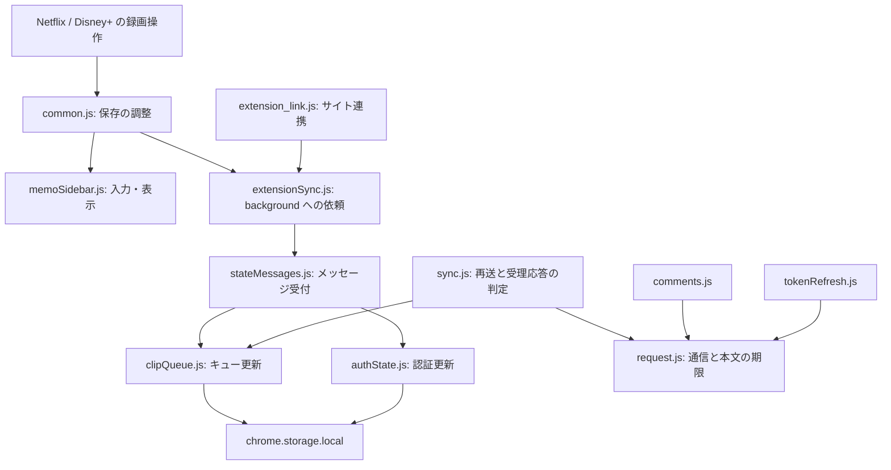

# 設計と責務の境界

Netflix・Disney+ の録画、サイト連携、コメント、同期で共用する状態の更新を background service worker に集約します。
ページ固有のプレイヤー操作は各サービスの content script が担当します。

## 状態を更新する場所

| 状態・処理 | 担当 | 保証すること |
|---|---|---|
| 未送信キューの追加・受理分削除 | [clipQueue.js](../src/background/clipQueue.js) | 同じ処理列で read/modify/write し、別タブの保存や同期完了が上書きしない |
| トークン保存・解除 | [authState.js](../src/background/authState.js) | 同期・コメント・token refresh と同じ認証処理列を使い、古い応答が新トークンを消さない |
| 初回 instance ID | `authState.js` | 同時要求で Promise を共有し、永続化後に応答する。失敗後は再試行可能 |
| 認証状態の消去 | [storage.js](../src/shared/storage.js) | トークン・有効期限・backoff・linked を一度の書込みで更新する |
| 保存パネルの DOM・入力・終了 | [memoSidebar.js](../src/content/memoSidebar.js) | セッションを管理し、古い保存完了が新しいパネルを変更しない |

認証の処理列とローカルキューの処理列は独立しています。
ネットワークが止まっても、キューへの保存は通信を待ちません。
処理列は前の処理が失敗しても後続を実行します。タブ内だけの mutex で共有 storage の競合を防ごうとしないでください。

`sync.js` が提供していた汎用排他処理は [exclusive.js](../src/background/exclusive.js) に分離しました。
認証・コメント・token refresh は同期実装へ依存せず、この共通の処理列を使います。

## 入力と通信の境界

- [clipPayload.js](../src/shared/clipPayload.js) は DOM・storage を参照しない入力正規化です。相対URLの基準は引数で受け取り、旧フィールド名を吸収します。負の時刻、終了≦開始、空の作品・サービス名等はキュー書込み前に拒否します。
- [stateMessages.js](../src/background/stateMessages.js) は Chrome の listener と処理本体を分離します。認証保存・解除は、送信元URLがサイトの Origin と一致する場合だけ受け付けます。
- [runtime.js](../src/shared/runtime.js) は callback 形式の runtime 通信を Promise 化し、Chrome のエラーや空応答を保存成功として扱いません。
- [request.js](../src/background/request.js) は fetch と JSON 本文の読込みに合計15秒の期限を設け、期限切れ時に abort します。同期、コメント、token refresh で共用します。

HTTP status と本文の意味は各 API モジュールが判定します。通信ヘルパーは API の業務判断やキューの削除を行いません。

## 保存完了と同期完了

保存パネルは background がローカルキューへの書込みを確認した時点で閉じます。
サイト同期は別に進み、応答が遅くても動画を再開できます。保存失敗はパネルに返し、同期を開始しません。
パネルを開いた時点で `clientItemId` と `createdAt` を固定し、再試行時も同じ値を使います。
再送後の重複防止はサーバー側の受理記録との契約に依存します。

## テストと今後の変更

- [queue-concurrency.test.mjs](../test/queue-concurrency.test.mjs): 12件の同時保存と、同期後の削除に割り込む保存。
- [architecture.test.mjs](../test/architecture.test.mjs): 認証競合、送信元検証、ID発行、失敗後の回復、通信中のローカル保存、入力境界。
- [request.test.mjs](../test/request.test.mjs): ヘッダー待ち・本文待ちの期限切れ。
- [save-service.test.mjs](../test/save-service.test.mjs): 永続化と同期の独立、保存失敗・空応答の扱い。
- [common.test.mjs](../test/content/common.test.mjs): ソースを書き換えず実際のUIモジュールを import し、表示セッションと再試行を検証。
- [record-sync.spec.mjs](../e2e/record-sync.spec.mjs): 配信サービスをまたぐ同時保存、保存失敗、通信停止後の alarm 再送。

プレイヤーの seek・playlist 進行と再生用 storage は、引き続き各サービスの実装にあります。
今後そこを統合する場合は、同一作品内の移動・別作品への遷移・タブをまたぐ再生に対するテストを先に用意してください。
